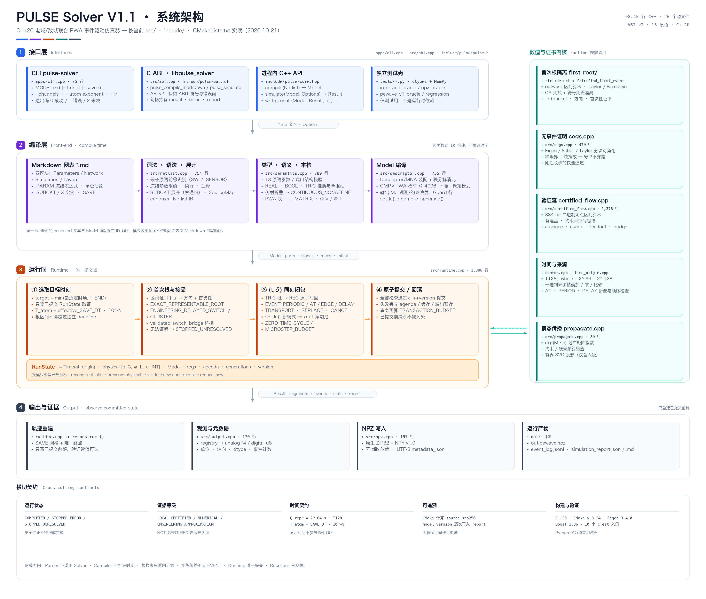
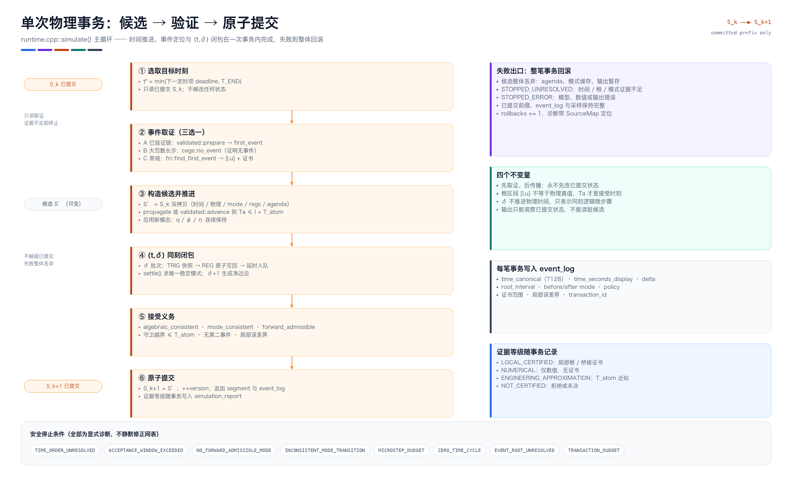
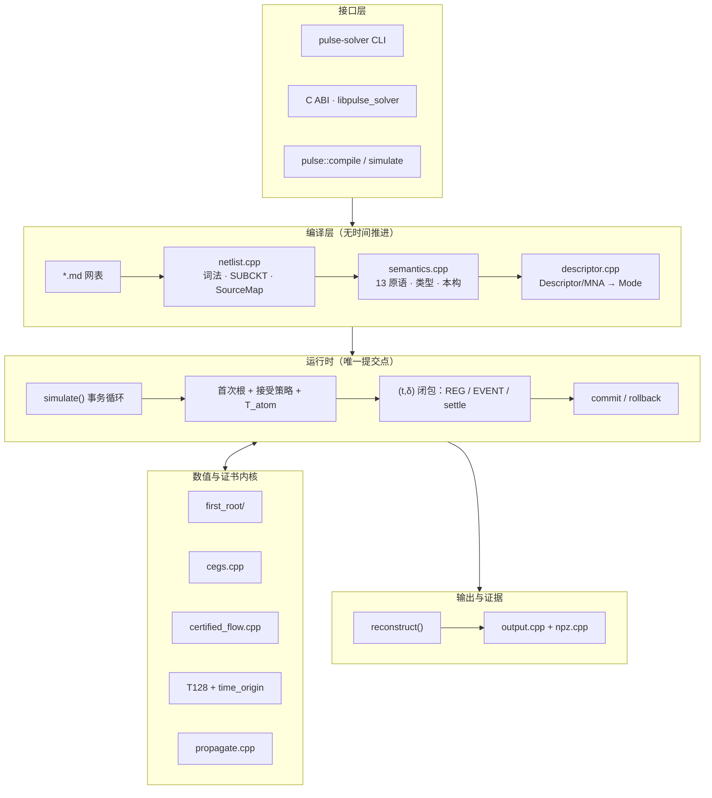

# PULSE Solver V1.1 架构图

本目录是**当前代码**的架构快照（2026-10-21，工作区非 git 仓库，故未记录 commit），
由 `render_architecture.py` 从 `src/`、`include/`、`CMakeLists.txt` 实读后绘制，不是对
[`docs/01_PULSE_V1.1_System_Architecture.md`](../01_PULSE_V1.1_System_Architecture.md) 的转抄。





## 图 1：分层系统架构

| 层 | 模块 | 源文件 | 职责 |
|---|---|---|---|
| ① 接口层 | CLI / C ABI / 进程内 API | `apps/cli.cpp`、`src/abi.cpp`、`include/pulse/pulse.h` | 解析参数、持有句柄、把诊断与报告返回给调用方；ABI v2 保留 ABI1 符号与错误码 |
| ② 编译层 | 词法语法 | `src/netlist.cpp` | 四区块 Markdown、冻结 `.PARAM` 表达式、SUBCKT 展开、SourceMap、canonical IR |
| ② 编译层 | 类型与本构 | `src/semantics.cpp` | 13 原语结构与参数校验、REAL/BOOL/TRIG 推断与单驱动、仿射式折叠、PWA 曲线 |
| ② 编译层 | Model 编译 | `src/descriptor.cpp` | Descriptor/MNA 装配与秩分解消元、CMP×PWA 模态枚举（≤ 4096）、`settle()` |
| ③ 运行时 | 事务循环 | `src/runtime.cpp` | 目标选择、首次根接受、`(t,δ)` 同刻闭包、原子提交/回滚；唯一提交点 |
| ④ 输出 | 重建与写出 | `src/output.cpp`、`src/npz.cpp` | 只对已提交前缀按 SAVE 网格取值，写 `out.pewave.npz`、`event_log.jsonl`、report |
| 内核列 | 首次根 | `src/first_root/` | outward 区间算术、Taylor/Bernstein 包络、CA 变换与符号变差隔离 |
| 内核列 | 无事件证明 | `src/cegs.cpp` | 分块对角化 + 缺陷界，证明长步内没有守卫穿越；证不出就退回根搜索 |
| 内核列 | 验证流 | `src/certified_flow.cpp` | 384-bit 二进制定点区间状态包络、有理基、`advance`、`switch_bridge` |
| 内核列 | 时间 | `src/common.cpp`、`src/time_origin.cpp` | T128（whole + 2⁻⁶⁴ + 2⁻¹²⁸）、十进制来源精确加乘比较 |
| 内核列 | 传播 | `src/propagate.cpp` | 模态内 `exp(M·h)` 增广矩阵指数 |

图中没有画出的内容（避免误导）：`build*/`、`reports/`、`deliverables/`、`research/`
是构建与证据产物，不属于运行时架构。

## 图 2：单次物理事务

`simulate()` 的主循环每一轮只提交一个物理时刻：

1. `target = min(最近 agenda deadline, T_END)`，只读取已提交 `S_k` 取证；
2. 三选一取证：已验证链 `validated::prepare → first_event`、大范数长步 `cegs::no_event`、常规 `fri::find_first_event`；
3. 深拷贝 `S_k` 得到候选，传播到 `Ta ≤ l + T_atom` 并应用新模态；
4. `(t,δ)` 闭包：TRIG 快照 → REG 原子写回 → EVENT 延时入队 → `settle()` → δ+1 净边沿；
5. 三项接受义务（代数相容、模态谓词、向前合法）与窗口/第二事件检查；
6. 全部通过才提交并写日志，否则整笔丢弃，已提交前缀不受污染。

## 可编辑的 Mermaid 版本



## 重新生成

```sh
python3 docs/architecture/render_architecture.py
```

脚本只依赖 Pillow 与系统字体（Hiragino Sans GB / Menlo），同时输出矢量 SVG 与 2× PNG；
版面由脚本内的坐标常量控制，改动文字后重新运行即可。两张图分别对应
`architecture()` 与 `transaction_flow()`。
